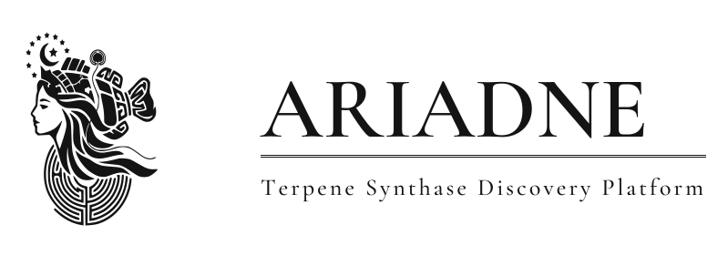

<p align="center">
  
</p>

<p align="center">
  <strong>Turn a research question into a validated shortlist of cembrene synthase candidates.</strong><br>
  <em>The multi-agent companion to the Ariadne engines — six expert agents, three deterministic engines, one auditable loop, no black-box endpoint.</em>
</p>

<p align="center">
  <em>Journal of Natural Products</em> (2026) &nbsp;·&nbsp; DOI: <a href="https://doi.org/10.1021/acs.jnatprod.6c00686">10.1021/acs.jnatprod.6c00686</a>
</p>

<p align="center">
  <a href="./README.zh-CN.md">中文</a> &nbsp;·&nbsp;
  <a href="#citation">Citation</a> &nbsp;·&nbsp;
  <a href="./docs/QUICKSTART.md">Docs</a>
</p>

|         |                                                                        |
| ------- | ---------------------------------------------------------------------- |
| Paper   | [![Journal of Natural Products 2026][jnp]][paper] [![DOI][doi]][paper] |
| Engine  | [![ariadne-tps 1.1.0][engine]][engine-repo] [![Python ≥ 3.10][python]][engine-repo] |
| App     | [![Version][version]][releases] [![Node ≥ 24.15][node]][releases] [![License MIT][license]][license-file] |

[jnp]: https://img.shields.io/badge/J.%20Nat.%20Prod.-2026-4B607C?style=flat-square
[doi]: https://img.shields.io/badge/DOI-10.1021%2Facs.jnatprod.6c00686-4B607C?style=flat-square
[paper]: https://doi.org/10.1021/acs.jnatprod.6c00686
[engine]: https://img.shields.io/badge/ariadne--tps-1.1.0-4B607C?style=flat-square
[python]: https://img.shields.io/badge/Python-%E2%89%A53.10-4B607C?style=flat-square&logo=python&logoColor=white
[engine-repo]: https://github.com/zhaorui-bi/Ariadne
[version]: https://img.shields.io/badge/Version-0.1.0--beta.1-4B607C?style=flat-square
[node]: https://img.shields.io/badge/Node-%E2%89%A524.15-4B607C?style=flat-square&logo=node.js&logoColor=white
[releases]: https://github.com/zhaorui-bi/AriadneBuddy
[license]: https://img.shields.io/badge/License-MIT-4B607C?style=flat-square
[license-file]: ./LICENSE

<p align="center"><sub>Beta · v0.1.0-beta.1</sub></p>

---

##  What this is

**AriadneBuddy** wraps the published
[Ariadne](https://github.com/zhaorui-bi/Ariadne) platform — the four-stage,
fully auditable pipeline behind the coral cembrene-class synthases (CeeSs)
reported in *J. Nat. Prod.* 2026 — in a multi-agent workbench that walks the
whole scientific method, not just the screening:

- **Expert stages and independent review** — the coordinator prepares stage
  artifacts and can delegate literature checks, hypothesis critique, and output
  quality review to subagents with fresh contexts.
- **Three deterministic engines as tools** — HMM retrieval (pyhmmer), ESM2
  semantic scoring, and feature-space structure retrieval (nearest-reference
  classification). Every score, E-value, probability, and nearest reference
  comes from engine artifacts; the conversational model never invents science.
- **Research sessions** — select a task from the session list in Web or desktop
  to see current progress, results, and pending reviews. Expand Activity and files
  for jobs, verified artifacts, and the task timeline. Decisions are caller-declared,
  and audit failures block handoff.

The loop it closes — **computational nomination → experimental design →
validation interpretation → iterative optimization** — runs through a CLI, a
full terminal TUI, a local web app, and an Electron desktop app. Every interface
shares one appearance layer: a parchment and ink scale, four pigments, and
engraved Greek-key ornament. [Design](./docs/DESIGN.md) is the token reference.

##  The closed loop

<p align="center">
  
</p>

| Stage | Owner | What happens | Frozen artifact |
| --- | --- | --- | --- |
| readiness | system | backend health, engine identity, reference data | frozen mandate + backend fingerprint |
| literature | agent | citable sources, findings, gaps | `sources / findings / gaps` |
| hypothesis | agent | testable statements tied to the target class | `hypotheses[{statement, prediction}]` |
| **gate** | **human** | approve before any compute is spent | — |
| pathway | agent | substrate → product steps + enzyme slots | `product / steps / enzyme_slots` |
| discovery | engine | pyhmmer best-hit search, threshold filters | candidates FASTA + hits table |
| filtering | engine | coverage / length / near-duplicate QC | filtered FASTA + filter report |
| nomination | engine | ESM2 CeeSs scoring + nearest-reference retrieval | shortlist with full evidence rows |
| audit | engine | claim-evidence ledger, NOM-001…008 codes | pass / warn / fail per candidate |
| **gate** | **human** | approve the shortlist before experiments | — |
| experiment | agent | expression system, assay, controls, decision criteria | `designs[]` |
| validation | agent | outcome (supported / refuted / inconclusive) + interpretation | `records[]` |
| **gate** | **human** | iterate (≤ 4 rounds, back to hypothesis) or conclude | — |
| handoff | system | verification of lineage and review of validation records (`validated`) | task record + manifests |

Every engine job carries a `run-manifest.json` — sha256 fingerprints of the
request, inputs, non-secret scientific configuration, and configured output —
and the controller re-verifies each stage output before consuming it. Without
torch/transformers the loop still runs behind an explicit
`proceed_without_esm` waiver, with nominations carried by HMM +
feature-space evidence as `conditional_nomination`.

For molluscan KS batches, the `afpk-ks` workflow compares FAS I, mitochondrial
FAS II, and animal PKS bit scores. It brings putative AFPK nominations and
optional AFPK-finder cluster records into the same session for review.
See [Research tasks](./docs/RESEARCH_TASKS.md#molluscan-ks-screening) for the workflow.

##  Appearance

The palette is four pigments over a parchment and ink scale. Parchment carries the
work, ink carries the words, and colour appears only where a surface must state
something: aegean for interactive state, terracotta for anything awaiting a human
decision, olive for verified evidence.

<table>
  <thead>
    <tr><th>Token</th><th>Light</th><th>Dark</th></tr>
  </thead>
  <tbody>
    <tr><td>--tb-paper</td><td style="background:#fbfbfa;width:72px;height:20px;border:1px solid rgb(0 0 0 / 0.25)">&#160;</td><td style="background:#171717;width:72px;height:20px;border:1px solid rgb(255 255 255 / 0.25)">&#160;</td></tr>
    <tr><td>--tb-ink</td><td style="background:#242424;width:72px;height:20px;border:1px solid rgb(0 0 0 / 0.25)">&#160;</td><td style="background:#e8e8e8;width:72px;height:20px;border:1px solid rgb(255 255 255 / 0.25)">&#160;</td></tr>
    <tr><td>--tb-aegean</td><td style="background:#1f5688;width:72px;height:20px;border:1px solid rgb(0 0 0 / 0.25)">&#160;</td><td style="background:#7fb2d9;width:72px;height:20px;border:1px solid rgb(255 255 255 / 0.25)">&#160;</td></tr>
    <tr><td>--tb-terracotta</td><td style="background:#a8452c;width:72px;height:20px;border:1px solid rgb(0 0 0 / 0.25)">&#160;</td><td style="background:#e08a63;width:72px;height:20px;border:1px solid rgb(255 255 255 / 0.25)">&#160;</td></tr>
    <tr><td>--tb-olive</td><td style="background:#4f6021;width:72px;height:20px;border:1px solid rgb(0 0 0 / 0.25)">&#160;</td><td style="background:#a3b86a;width:72px;height:20px;border:1px solid rgb(255 255 255 / 0.25)">&#160;</td></tr>
    <tr><td>--tb-marble</td><td style="background:#f4f1ea;width:72px;height:20px;border:1px solid rgb(0 0 0 / 0.25)">&#160;</td><td style="background:#232323;width:72px;height:20px;border:1px solid rgb(255 255 255 / 0.25)">&#160;</td></tr>
  </tbody>
</table>

##  The 21 agent tools

| Group | Tools |
| --- | --- |
| Engines | `ariadne_status` · `ariadne_catalog` · `ariadne_build_hmm` · `ariadne_discover` · `ariadne_filter` · `ariadne_score_candidates` · `ariadne_classify` · `ariadne_pipeline_run` · `ariadne_audit_nomination` |
| Durable jobs | `ariadne_job_list` · `ariadne_job_status` · `ariadne_job_manifest` · `ariadne_job_log` · `ariadne_job_artifacts` · `ariadne_job_cancel` |
| Research controller | `ariadne_research_create` · `ariadne_research_status` · `ariadne_research_list` · `ariadne_research_advance` · `ariadne_research_respond` · `ariadne_research_cancel` |

##  A nomination request

```json
{
  "target_class": "cembrene-class TPS (CeeSs)",
  "input_proteins": ["proteins.faa"],
  "query_hmm": "input/query.hmm",
  "reference_dir": "input/references",
  "tps_workbook": "TPS.xlsx",
  "thresholds": { "min_score": 0, "max_evalue": 0.001,
                  "min_length": 300, "ceess_threshold": 0.9, "top_k": 5 }
}
```

Runnable cases live in [`examples/cases/`](./examples/cases/): a standard CeeSs
screen, a relaxed exploratory screen, and a pathway-first TPS inventory.

##  Install

**Prerequisites** — Node.js ≥ 24.15, npm, pnpm 12; Python 3.10+ with an
[ariadne-tps](https://github.com/zhaorui-bi/Ariadne) checkout (`pyhmmer,
pyrodigal, scikit-learn, openpyxl`; a checkout-local `.venv` is detected
automatically); optionally `pip install ariadne-tps[esm]` for ESM2 scoring;
any OpenAI-compatible model API key (no login flows).

```bash
git clone https://github.com/zhaorui-bi/AriadneBuddy && cd AriadneBuddy
npm run setup                                          # install + build + branded web UI
./bin/ariadnebuddy onboard --ariadne-repo /path/to/Ariadne \
                           --provider zai --api-key-env ZAI_API_KEY
./bin/ariadnebuddy doctor --probe                      # one-shot health check
```

##  Use

```bash
./bin/ariadnebuddy web        # Greek/Roman web workbench → http://127.0.0.1:58627
./bin/ariadnebuddy            # full terminal TUI
./bin/ariadnebuddy chat       # lightweight REPL
npm start                     # Electron desktop app
```

Then just ask — *“用 Ariadne 引擎对 input/all_tps.fasta 做 cembranoid CeeSs
提名，走完整闭环”* — and approve the gates. Model-free task control also
works (`ariadnebuddy research create|status|list|advance|respond|cancel`), and

```bash
node engine/apps/ariadne-buddy/scripts/run-real-engine-demo.mjs /path/to/Ariadne
```

drives the entire loop against the real pyhmmer/sklearn engines and prints
the nominated candidates with their evidence.

##  Documentation

| Doc | Contents |
| --- | --- |
| [Quick start](./docs/QUICKSTART.md) | install, onboard, verify, first run |
| [Architecture](./docs/ARCHITECTURE.md) | the four layers, boundaries, security posture |
| [Design](./docs/DESIGN.md) | the palette, tokens, and motif layer |
| [Keyboard](./docs/KEYBOARD.md) | desktop, Research Desk, and command-line keys |
| [Glossary](./docs/GLOSSARY.md) | vocabulary, task states, audit codes |
| [Examples](./docs/EXAMPLES.md) | worked artifact shapes |
| [Scientific workflow discipline](./docs/SCIENTIFIC_WORKFLOWS.md) | evidence classes, stage contracts, claims language |
| [Research tasks](./docs/RESEARCH_TASKS.md) | the state machine, responses, guarantees |
| [Changelog](./CHANGELOG.md) · [Contributing](./CONTRIBUTING.md) · [Security](./SECURITY.md) | release history, change boundaries, reporting |
| [FAQ](./docs/FAQ.md) · [Troubleshooting](./docs/TROUBLESHOOTING.md) · [Release](./docs/RELEASE.md) | answers, fixes, shipping |
| 中文文档 | [快速上手](./docs/zh-CN/QUICKSTART.md) · [常见问题](./docs/zh-CN/FAQ.md) · [故障排查](./docs/zh-CN/TROUBLESHOOTING.md) · [科学工作流纪律](./docs/zh-CN/DOMAIN_WORKFLOW.md) · [设计语言](./docs/zh-CN/DESIGN.md) · [术语表](./docs/zh-CN/GLOSSARY.md) |

Brand assets: `build/logo.svg` is the canonical mark — it is packaged into the desktop
application and mirrored byte-for-byte into the Web UI as `web-ui/ariadne-logo.svg`.
`docs/logo.svg` is the display lockup used in these READMEs.

Documentation language: English is the source language. Every English document under
`docs/` has a Chinese mirror under `docs/zh-CN/`, and the two READMEs are kept symmetric.
The interface itself ships both languages and follows the language of the host system.

##  Verification

Everything is gated locally by `npm run check` — lint, typecheck,
coverage-threshold tests, the Python adapter suite, packaging, desktop
startup, TUI regression, and the MCP / research / web smokes; the research
smoke drives the entire loop to a validated handoff.

##  Citation

If AriadneBuddy contributes to your research, please cite the accompanying
*Journal of Natural Products* article (the Ariadne paper):

> Wang, Y.; Yu, M.; Jiang, Z.; Zhou, C.; Feng, W.; Yu, K.; Ju, J.; Li, F.
> "Identification of Cembrene Synthases Uncovers Polyphyletic Origins of
> 14-Membered Carbocyclic Cembranoids Biosynthesis in Corals."
> *Journal of Natural Products*, **2026**, American Chemical Society.
> DOI: [10.1021/acs.jnatprod.6c00686](https://doi.org/10.1021/acs.jnatprod.6c00686). ISSN 0163-3864.

```bibtex
@article{Wang2026Ariadne,
  author  = {Wang, Yinhao and Yu, Mengmeng and Jiang, Zhaorui and Zhou, Chengyu and Feng, Wei and Yu, Ke and Ju, Jianhua and Li, Feng},
  title   = {Identification of Cembrene Synthases Uncovers Polyphyletic Origins of 14-Membered Carbocyclic Cembranoids Biosynthesis in Corals},
  journal = {Journal of Natural Products},
  year    = {2026},
  doi     = {10.1021/acs.jnatprod.6c00686},
  url     = {https://doi.org/10.1021/acs.jnatprod.6c00686},
  issn    = {0163-3864},
  publisher = {American Chemical Society},
}
```

Please also report the AriadneBuddy version (`ariadnebuddy --version`), the
ariadne-tps revision, reference snapshot, HMM libraries, and ESM model used.
See [CITATION.cff](./CITATION.cff) for this software's own record.

##  Support

- Bugs, questions, and feature requests:
  [github.com/zhaorui-bi/AriadneBuddy/issues](https://github.com/zhaorui-bi/AriadneBuddy/issues)
- Security reports: the private advisory channel described in [SECURITY.md](./SECURITY.md).
  Do not open a public issue for an unpatched vulnerability.

##  License & acknowledgements

MIT. Built on the [OpenAqua-Harness](https://github.com/zhaorui-bi/OpenAqua-Harness)
template, powered by the vendored [Kimi Code](https://github.com/MoonshotAI/kimi-code)
agent engine (own license under `engine/`), bridging the MIT
[ariadne-tps](https://github.com/zhaorui-bi/Ariadne) engines as an external
checkout. Nominated candidates still require heterologous expression and
product confirmation before any claim of function — a screening score is not
activity.
