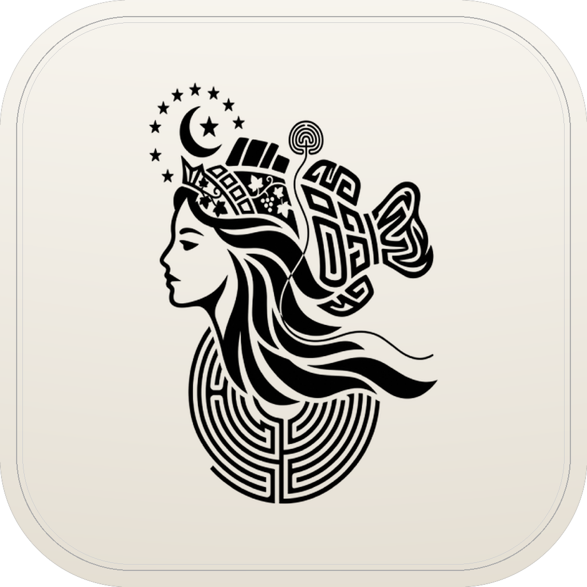
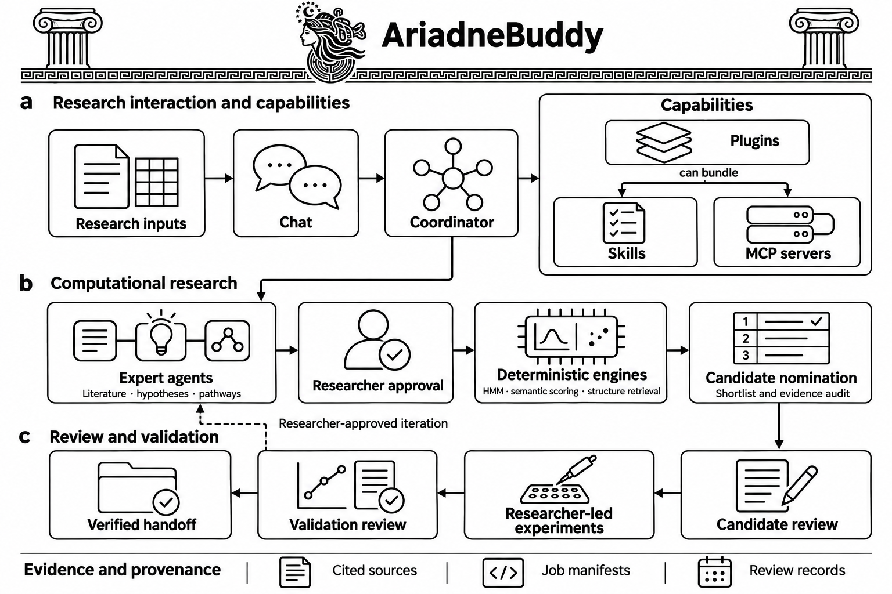

<h1 align="center">
  
  <br>
  AriadneBuddy
</h1>

<p align="center">A multi-agent research workbench for animal natural product discovery.</p>

<p align="center">
  <a href="#research-framework">Framework</a> &nbsp;·&nbsp;
  <a href="#research-cases">Research cases</a> &nbsp;·&nbsp;
  <a href="#reproduce">Reproduce</a> &nbsp;·&nbsp;
  <a href="#citation">Citation</a> &nbsp;·&nbsp;
  <a href="./README.zh-CN.md">中文</a>
</p>

<p align="center"><sub>0.1.0-beta.1 &nbsp;·&nbsp; <a href="./LICENSE">MIT license</a></sub></p>

## Overview

AriadneBuddy follows a research question from literature review and hypothesis development to computational candidate nomination and researcher-led validation. It coordinates expert roles through Chat and calls the external Ariadne engines for screening scores and classifications. Researchers review the evidence at explicit checkpoints and decide whether experimental results support a handoff or another round of investigation. [Scientific workflow](./docs/SCIENTIFIC_WORKFLOWS.md)

The scientific foundation is **Ariadne**, the platform used in the published study of cembrene synthases in corals. [Ariadne engine](https://github.com/zhaorui-bi/Ariadne) · [Wang et al., *Journal of Natural Products* (2026)](https://doi.org/10.1021/acs.jnatprod.6c00686)

## Research framework

<p align="center">
  <a href="./docs/images/ariadnebuddy-framework.png"></a>
</p>

**Figure 1.** Scientific coordination, deterministic computation, and human review in one auditable research loop. The dashed arrow marks researcher-approved iteration.

| Layer | Role in the workflow | Evidence retained |
| --- | --- | --- |
| **Expert roles** | Review literature, develop testable hypotheses, and reconstruct candidate pathways. Plugins can bundle reusable Skills and MCP tool connections. | Cited sources, hypotheses, and stage artifacts |
| **Deterministic engines** | Run HMM retrieval, ESM2 semantic scoring, and feature-space structure retrieval. Audit the evidence behind nominated candidates. | Scores, shortlist, and SHA-256 run manifests |
| **Researcher review** | Review nominations, record experimental results, and decide whether to iterate or conclude. | Review decisions and validation records |

The same research controller serves the desktop app, local Web, and command line. [Architecture](./docs/ARCHITECTURE.md) · [Research task lifecycle](./docs/RESEARCH_TASKS.md)

## Research cases

| Case | What you can inspect |
| --- | --- |
| **Coral cembrene synthases** | The CeeSs nomination request and its inputs to the Ariadne engines. [Case configuration](./examples/cases/ceess-coral-transcriptome.json) |
| **Molluscan AFPK screening** | A reanalysis of published KS domains using three HMM profiles, with an optional comparison to the original AFPK-finder and a shortlist for researcher review. [Case notes in Chinese](./examples/cases/AFPK_MOLLUSC.md) |

## Reproduce

For a source build, start with Node.js 24.15 or later and an [Ariadne checkout](https://github.com/zhaorui-bi/Ariadne) with its Python environment. The onboarding example uses Z.AI and expects `ZAI_API_KEY` in your local shell. ESM2 scoring requires the optional ESM dependencies. [Prerequisites and other providers](./docs/QUICKSTART.md)

```bash
git clone https://github.com/zhaorui-bi/AriadneBuddy.git
cd AriadneBuddy
npm ci
npm run setup
./bin/ariadnebuddy onboard --ariadne-repo /path/to/Ariadne \
  --provider zai --api-key-env ZAI_API_KEY
./bin/ariadnebuddy doctor --probe --probe-model
./bin/ariadnebuddy web
```

Use `npm start` for the desktop app, or run `./bin/ariadnebuddy` for the terminal interface. [Quick start](./docs/QUICKSTART.md)

**Model-free demo.** With the Ariadne tutorial inputs in your engine checkout, run the real computation and inspect the candidate evidence. The demo records a placeholder for experimental validation.

```bash
ARIADNE_REPO=/path/to/Ariadne node engine/apps/ariadne-buddy/scripts/run-real-engine-demo.mjs
```

`npm run smoke:research` exercises the controller with a stub adapter. [Examples and artifact formats](./docs/EXAMPLES.md) · [Verification commands](./CONTRIBUTING.md)

## Documentation

- [Research tasks](./docs/RESEARCH_TASKS.md) · [Scientific workflow](./docs/SCIENTIFIC_WORKFLOWS.md) · [Command-line setup](./docs/QUICKSTART.md)
- [Architecture](./docs/ARCHITECTURE.md) · [Visual design](./docs/DESIGN.md) · [Keyboard controls](./docs/KEYBOARD.md)
- [Troubleshooting](./docs/TROUBLESHOOTING.md) · [Issue tracker](https://github.com/zhaorui-bi/AriadneBuddy/issues) · [Security reporting](./SECURITY.md)

## Citation

Cite AriadneBuddy through its [software citation record](./CITATION.cff) and cite the Ariadne paper when referring to the engine or its published findings.

> Wang, Y., Yu, M., Jiang, Z. et al. Identification of Cembrene Synthases Uncovers Polyphyletic Origins of 14-Membered Carbocyclic Cembranoids Biosynthesis in Corals. *Journal of Natural Products* (2026). [10.1021/acs.jnatprod.6c00686](https://doi.org/10.1021/acs.jnatprod.6c00686)

<details>
<summary>BibTeX for the Ariadne paper</summary>

```bibtex
@article{Wang2026Ariadne,
  author  = {Wang, Yinhao and Yu, Mengmeng and Jiang, Zhaorui and Zhou, Chengyu and Feng, Wei and Yu, Ke and Ju, Jianhua and Li, Feng},
  title   = {Identification of Cembrene Synthases Uncovers Polyphyletic Origins of 14-Membered Carbocyclic Cembranoids Biosynthesis in Corals},
  journal = {Journal of Natural Products},
  year    = {2026},
  doi     = {10.1021/acs.jnatprod.6c00686},
}
```

</details>

For reproducibility, report the AriadneBuddy version, Ariadne revision, reference-data snapshot, HMM libraries, and ESM model used.

---

AriadneBuddy is licensed under [MIT](./LICENSE). It builds on [OpenAqua-Harness](https://github.com/zhaorui-bi/OpenAqua-Harness) and the vendored [Kimi Code](https://github.com/MoonshotAI/kimi-code) agent engine.
