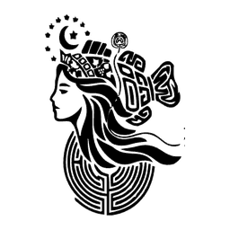

<p align="center">
  
</p>

<h1 align="center">AriadneBuddy</h1>

<p align="center"><strong>Beta · v0.1.0-beta.1</strong></p>

<p align="center">
  <em>Follow the thread: from literature to validated natural-product candidates.</em>
</p>

**AriadneBuddy** is an agentic scientific-discovery workbench for natural-product
genome mining. It turns domain-expert knowledge into agent-executable workflows:
multiple expert agents — Literature Surveyor (文献调研), Hypothesis Architect
(假说生成), Pathway Reconstructor (途径重构), Nomination Steward (候选提名),
Experimental Designer (实验设计), and Validation Interpreter (验证解读) —
collaborate across a durable, gated research loop, while the deterministic
[Ariadne](https://github.com/zhaorui-bi/Ariadne) engines run as agent-callable
tools: **HMM retrieval** (pyhmmer), **ESM2 semantic scoring**, and
**feature-space structure retrieval** (nearest-reference classification).

The result closes the loop: **computational nomination → experimental design →
validation interpretation → iterative optimization**, surfaced through CLI, TUI,
a local Web UI, and an Electron desktop app for human-in-the-loop decisions.

## The closed scientific loop

```
readiness → literature → hypothesis ──approve──→ pathway
                ↑                                   │
                │            discovery (HMM retrieval)
            iterate           filtering (QC + dedupe)
                │            nomination (ESM2 scoring + structure retrieval)
        validation ←─ experiment ←──approve── audit (claim-evidence ledger)
                └────────── conclude → handoff
```

Knowledge stages are authored by the expert agents as frozen, hash-verified
artifacts; compute stages launch deterministic engine jobs with provenance
manifests. Human decision gates (hypothesis approval, nomination approval,
iterate/conclude) are first-class attention items — caller-declared responses
are never treated as verified human approval.

## What's inside

- `engine/apps/ariadne-buddy` — the harness application on the Kimi Code engine:
  - `src/ariadne/tools.ts` — 21 MCP tools (engines, jobs, research controller)
  - `src/ariadne/research.ts` — the gated closed-loop state machine
  - `backend/ariadne_cli.py` — the stable JSON adapter over the ariadne-tps engines
  - `theme/ariadne.css` — the ancient Greek/Roman visual system (parchment,
    aegean blue, verdigris, gold, terracotta; meander fret)
  - `skills/ariadne`, `skills/ariadne-campaign` — agent operating skills
- Root — Electron shell, icons (the official Ariadne mark on parchment), packaging, release tooling

## Quick start

```bash
npm run setup            # pnpm install + build engine app + branded web UI
./bin/ariadnebuddy onboard --ariadne-repo /path/to/Ariadne   # engine + model
./bin/ariadnebuddy web   # local workbench at http://127.0.0.1:58627
```

Engine requirements: an [ariadne-tps](https://github.com/zhaorui-bi/Ariadne)
checkout with `pyhmmer, pyrodigal, scikit-learn, openpyxl` installed (its
`.venv` is detected automatically). ESM2 semantic scoring additionally needs
`torch`/`transformers` (`pip install ariadne-tps[esm]`); without them the loop
runs with an explicit `proceed_without_esm` waiver.

## Example nomination request

```json
{
  "target_class": "cembrene-class TPS (CeeSs)",
  "input_proteins": ["proteins.faa"],
  "query_hmm": "input/query.hmm",
  "reference_dir": "input/references",
  "tps_workbook": "TPS.xlsx",
  "thresholds": { "min_score": 0, "max_evalue": 0.001,
                  "min_length": 300, "ceess_threshold": 0.9, "top_k": 5 }
}
```

See `examples/cases/` for complete requests, and
`engine/apps/ariadne-buddy/skills/ariadne/SKILL.md` for the full operating
contract.

## License

MIT. The vendored Kimi Code engine keeps its own license under `engine/`; the
Ariadne engines are bridged as an external checkout and remain MIT.
