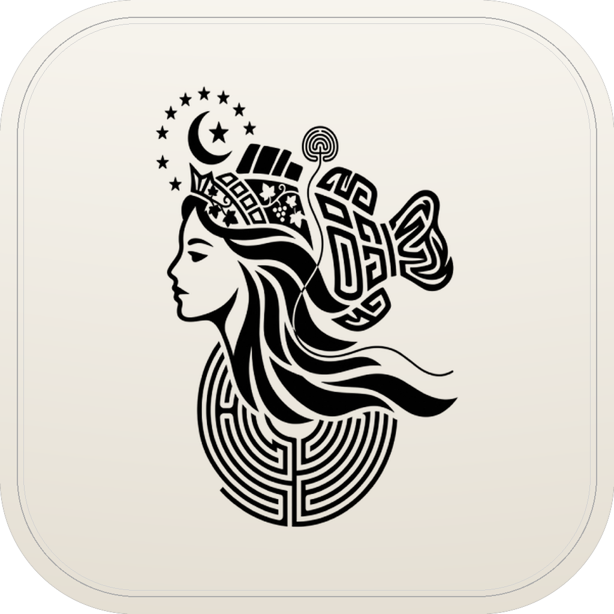
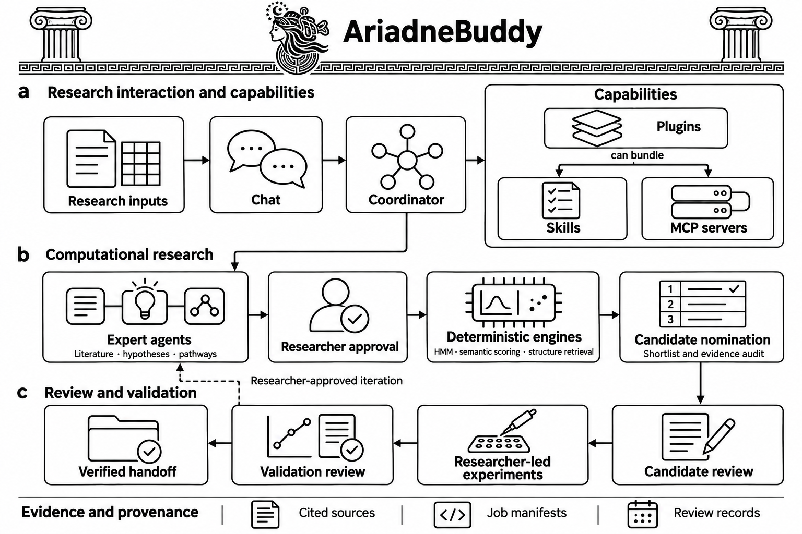

<h1 align="center">
  
  <br>
  AriadneBuddy
</h1>

<p align="center">面向动物天然产物发现的多智能体科研工作台，保留从研究问题到候选证据的完整记录。</p>

<p align="center">
  <a href="#研究框架">研究框架</a> &nbsp;·&nbsp;
  <a href="#研究案例">研究案例</a> &nbsp;·&nbsp;
  <a href="#复现">复现</a> &nbsp;·&nbsp;
  <a href="#引用">引用</a> &nbsp;·&nbsp;
  <a href="./README.md">English</a>
</p>

<p align="center"><sub>0.1.0-beta.1 &nbsp;·&nbsp; <a href="./LICENSE">MIT 许可</a></sub></p>

## 概览

AriadneBuddy 将文献调研、假说生成、计算提名和实验验证串成一条可审计的流程。Chat 协调专家角色，由外部 Ariadne 引擎生成筛查得分和分类。研究者在关键节点审核证据，根据实验结果决定修订假说，或结题并完成交接。 [科学工作流](./docs/zh-CN/DOMAIN_WORKFLOW.md)

**Ariadne** 是 AriadneBuddy 调用的科学计算平台，已用于发表的珊瑚 cembrene 合酶研究。 [Ariadne 引擎](https://github.com/zhaorui-bi/Ariadne) · [Wang 等，*Journal of Natural Products*（2026）](https://doi.org/10.1021/acs.jnatprod.6c00686)

## 研究框架

<p align="center">
  <a href="./docs/images/ariadnebuddy-framework.png"></a>
</p>

**图 1.** 研究协调、确定性计算与人工审核组成可审计的闭环。虚线箭头表示经研究者批准后返回假说阶段。

| 层级 | 在流程中的作用 | 保留的证据 |
| --- | --- | --- |
| **专家角色** | 调研文献、提出可检验的假说并重构候选途径。Plugins 可以打包可复用的 Skills 和 MCP 工具连接。 | 文献来源、假说与阶段产物 |
| **确定性引擎** | 执行 HMM 检索、ESM2 语义打分和特征空间结构检索，并审计候选的提名依据。 | 得分、候选名单与 SHA-256 作业清单 |
| **研究者审核** | 审核候选，记录实验结果，并决定继续迭代或结题。 | 审核决定与验证记录 |

桌面端、本地 Web 和命令行共用同一研究控制器。 [架构说明](./docs/ARCHITECTURE.md) · [研究任务生命周期](./docs/RESEARCH_TASKS.md)

## 研究案例

| 案例 | 可查看的内容 |
| --- | --- |
| **珊瑚 cembrene 合酶** | CeeSs 候选提名请求和 Ariadne 引擎的输入。 [案例配置](./examples/cases/ceess-coral-transcriptome.json) |
| **软体动物 AFPK 筛查** | 用三个 HMM 模型重新分析已发表的 KS 结构域，可对照原版 AFPK-finder 的结果，再由研究者审核候选。 [案例说明](./examples/cases/AFPK_MOLLUSC.md) |

## 复现

从源码构建需要 Node.js 24.15 或更高版本，以及已配置 Python 环境的 [Ariadne 检出目录](https://github.com/zhaorui-bi/Ariadne)。下例使用 Z.AI，运行前请在本地 Shell 中设置 `ZAI_API_KEY`。ESM2 打分需安装可选的 ESM 依赖。 [依赖与其他模型提供商](./docs/zh-CN/QUICKSTART.md)

```bash
git clone https://github.com/zhaorui-bi/AriadneBuddy.git
cd AriadneBuddy
npm ci
npm run setup
./bin/ariadnebuddy onboard --ariadne-repo /path/to/Ariadne \
  --provider zai --api-key-env ZAI_API_KEY
./bin/ariadnebuddy doctor --probe --probe-model
./bin/ariadnebuddy web
```

运行 `npm start` 打开桌面版，或运行 `./bin/ariadnebuddy` 打开终端界面。 [快速上手](./docs/zh-CN/QUICKSTART.md)

**免模型演示。** 在 Ariadne 检出目录备好教程输入后，可运行实际计算并检查候选证据。演示会为实验验证保留一条占位记录。

```bash
ARIADNE_REPO=/path/to/Ariadne node engine/apps/ariadne-buddy/scripts/run-real-engine-demo.mjs
```

`npm run smoke:research` 使用测试适配器验证研究控制器。 [示例与产物格式](./docs/EXAMPLES.md) · [验证命令](./CONTRIBUTING.md)

## 文档

- [研究任务](./docs/RESEARCH_TASKS.md) · [科学工作流](./docs/zh-CN/DOMAIN_WORKFLOW.md) · [命令行配置](./docs/zh-CN/QUICKSTART.md)
- [架构说明](./docs/ARCHITECTURE.md) · [视觉设计](./docs/zh-CN/DESIGN.md) · [键盘操作](./docs/KEYBOARD.md)
- [故障排查](./docs/zh-CN/TROUBLESHOOTING.md) · [问题反馈](https://github.com/zhaorui-bi/AriadneBuddy/issues) · [安全报告](./SECURITY.md)

## 引用

使用 AriadneBuddy 时，可通过 [软件引用记录](./CITATION.cff) 引用本项目。引用 Ariadne 引擎或已发表的科学结果时，请同时引用对应论文。

> Wang, Y., Yu, M., Jiang, Z. et al. Identification of Cembrene Synthases Uncovers Polyphyletic Origins of 14-Membered Carbocyclic Cembranoids Biosynthesis in Corals. *Journal of Natural Products* (2026). [10.1021/acs.jnatprod.6c00686](https://doi.org/10.1021/acs.jnatprod.6c00686)

<details>
<summary>Ariadne 论文的 BibTeX</summary>

```bibtex
@article{Wang2026Ariadne,
  author  = {Wang, Yinhao and Yu, Mengmeng and Jiang, Zhaorui and Zhou, Chengyu and Feng, Wei and Yu, Ke and Ju, Jianhua and Li, Feng},
  title   = {Identification of Cembrene Synthases Uncovers Polyphyletic Origins of 14-Membered Carbocyclic Cembranoids Biosynthesis in Corals},
  journal = {Journal of Natural Products},
  year    = {2026},
  doi     = {10.1021/acs.jnatprod.6c00686},
}
```

</details>

为便于复现，请记录 AriadneBuddy 版本、Ariadne 修订号、参考数据快照、HMM 模型库和 ESM 模型。

---

AriadneBuddy 采用 [MIT 许可](./LICENSE)，基于 [OpenAqua-Harness](https://github.com/zhaorui-bi/OpenAqua-Harness) 和内置的 [Kimi Code](https://github.com/MoonshotAI/kimi-code) 智能体引擎构建。
